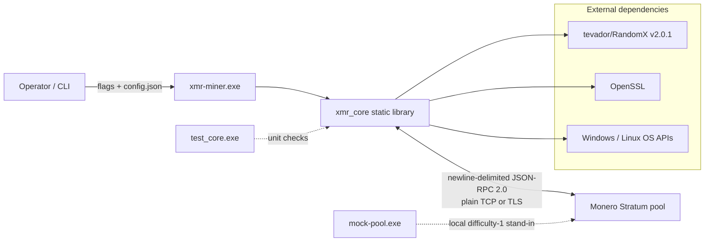
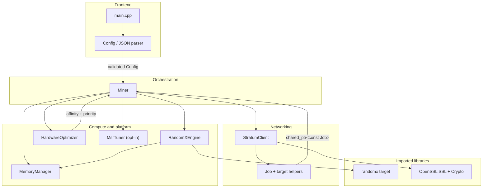
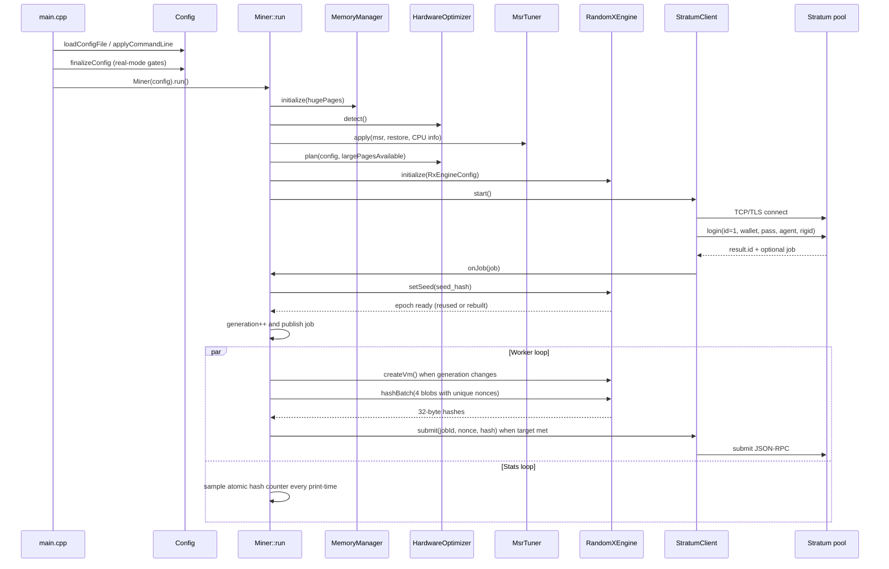
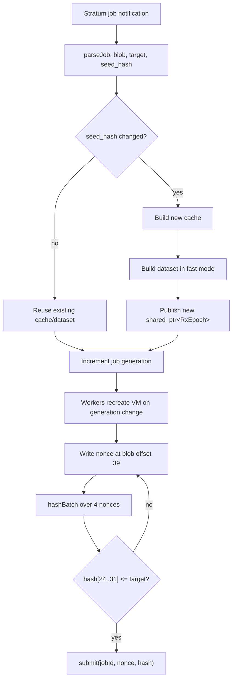
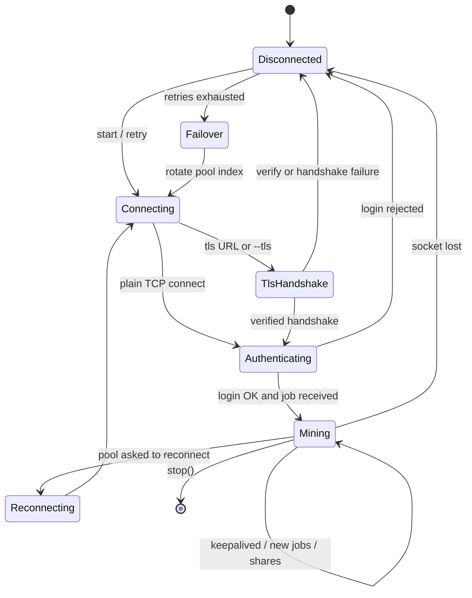
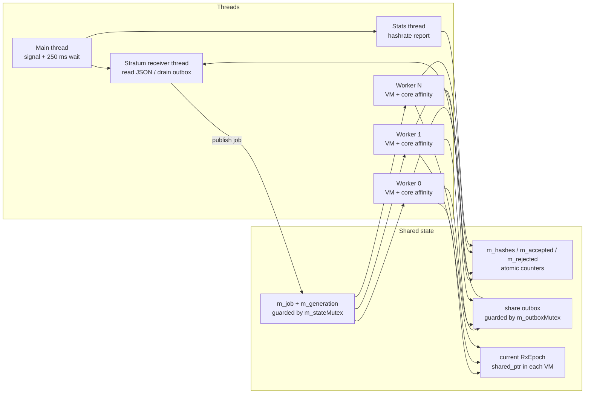
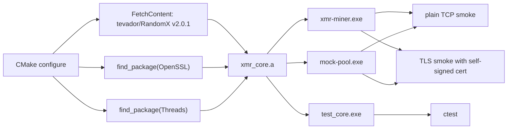
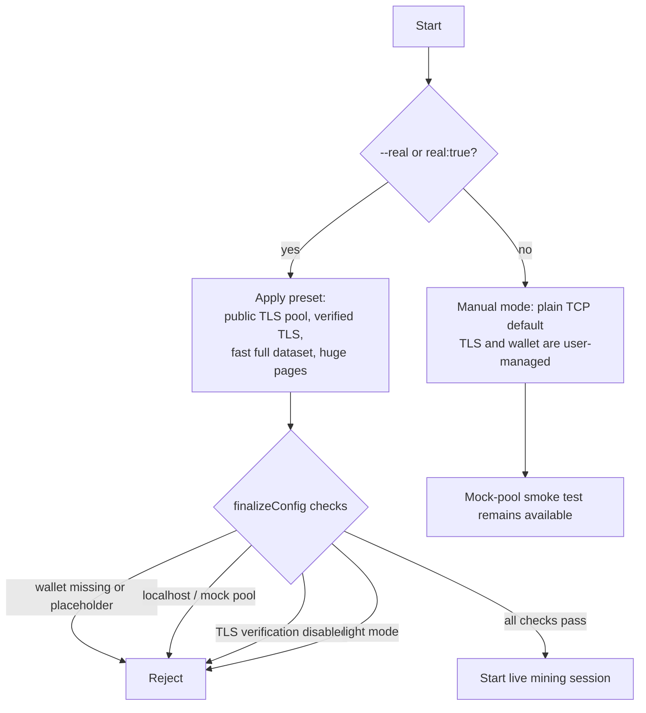

# Project Blueprint

This is the visual counterpart to [ARCHITECTURE.md](ARCHITECTURE.md). All
diagrams are [Mermaid](https://mermaid.js.org/) and render directly on GitHub,
so the blueprint stays version-controlled with the code.

## 1. System context



## 2. Module map

| Layer | Code | Responsibility |
|---|---|---|
| Entry / config | `src/main.cpp`, `src/config.cpp`, `src/json.cpp` | Parse config/CLI, apply `--real` preset, validate, set log level |
| Orchestration | `src/miner.cpp` | Startup, job fan-out, worker pool, hashrate statistics, shutdown |
| Networking | `src/stratum.cpp` | Login, jobs, target parsing, share submission, TLS, failover, keepalive |
| RandomX | `src/randomx_engine.cpp` | Cache/dataset epochs, VM creation, batched hashing, self-test |
| Memory | `src/memory_manager.cpp` | RAM/page/NUMA detection, allocation policy, page prefetch |
| Hardware | `src/hardware_optimizer.cpp` | CPUID/topology, thread plan, affinity, priority |
| MSR | `src/msr_tuner.cpp` | Opt-in prefetcher MSR presets and restore |
| Test tooling | `tools/mock_pool.cpp`, `tests/test_core.cpp` | Local smoke pool and unit tests |

## 3. Component architecture



## 4. Core class relationships

```mermaid
classDiagram
    class Config {
        +vector~PoolConfig~ pools
        +bool realMode
        +string mode
        +bool hugePages
    }
    class Miner {
        -Config m_config
        -RandomXEngine m_engine
        -StratumClient m_client
        -shared_ptr~const Job~ m_job
        +run() int
        -onJob(job)
        -worker(index, core, count)
        -statsLoop()
    }
    class StratumClient {
        -vector~PoolConfig~ pools
        -SocketHandle m_socket
        -SSL m_tls
        +start() bool
        +stop()
        +submit(id, nonce, hash) bool
        -parseJob(json, job) bool
    }
    class RandomXEngine {
        -shared_ptr~RxEpoch~ m_epoch
        -mutex m_mutex
        +initialize(config) bool
        +setSeed(seed) bool
        +createVm() RxVm
        +hashBatch(vm, inputs, count)
    }
    class MemoryManager {
        +initialize(wantLargePages) bool
        +canReserve(bytes) bool
        +prefetchPages(ptr, bytes)
    }
    class HardwareOptimizer {
        +detect() bool
        +plan(config, largePages) HardwarePlan
        +bindCurrentThread(core) bool
    }
    class MsrTuner {
        +apply(enable, restore, cpu) bool
        +restore()
    }

    Miner --> Config
    Miner --> StratumClient
    Miner --> RandomXEngine
    Miner --> MemoryManager
    Miner --> HardwareOptimizer
    Miner --> MsrTuner
    RandomXEngine --> MemoryManager
    StratumClient --> Config
```



## 5. Startup and mining sequence



## 6. Job and epoch lifecycle



## 7. Stratum connection state machine



## 8. Threading and shared state



## 9. Build and verification pipeline



## 10. Real-mode decision flow



## 11. Source tree

```text
E:\opencode\XMRig
├── CMakeLists.txt
├── config.example.json
├── README.md
├── docs/
│   ├── ARCHITECTURE.md
│   ├── BLUEPRINT.md        <-- this file
│   ├── HARDWARE_OPTIMIZER.md
│   ├── MEMORY_MANAGER.md
│   ├── RANDOMX_VM.md
│   └── STRATUM.md
├── include/xmr/
│   ├── common.hpp
│   ├── config.hpp
│   ├── hardware_optimizer.hpp
│   ├── json.hpp
│   ├── memory_manager.hpp
│   ├── miner.hpp
│   ├── msr_tuner.hpp
│   ├── randomx_engine.hpp
│   └── stratum.hpp
├── src/
│   ├── config.cpp
│   ├── hardware_optimizer.cpp
│   ├── json.cpp
│   ├── main.cpp
│   ├── memory_manager.cpp
│   ├── miner.cpp
│   ├── msr_tuner.cpp
│   ├── randomx_engine.cpp
│   └── stratum.cpp
├── tests/
│   ├── CMakeLists.txt
│   └── test_core.cpp
└── tools/
    └── mock_pool.cpp
```

> Build outputs under `build/` are intentionally ignored by Git.
